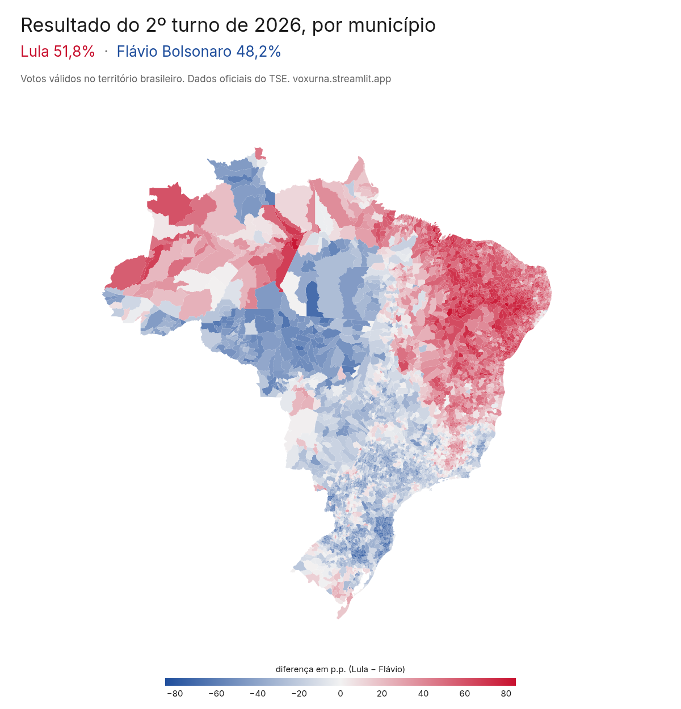

# Vox Urna

O 2º turno presidencial de 2026 visto só pelos boletins de urna do TSE. Tem a projeção que fiz antes da eleição, o confronto dela com o resultado e de onde veio a virada do Lula, além do pipeline de dados que chega nisso tudo.

> **Não é pesquisa eleitoral.** Ninguém foi entrevistado. A projeção usa metodologia própria e as análises usam os dados oficiais das urnas, que o TSE deixa abertos para qualquer cidadão.

**Dashboard:** https://voxurna.streamlit.app/

| A projeção, antes do 2º turno | O resultado oficial |
|---|---|
|  |  |

## Por que fiz isso

O resultado do 1º turno de 2026 me surpreendeu. Flávio Bolsonaro terminou com 47,0% dos votos válidos e Lula com 45,2%, uma diferença de 2,2 milhões de votos, quatro anos depois de Lula ganhar o 2º turno. O TSE publica o boletim de cada urna do país, então fui atrás deles para entender onde isso aconteceu e o que dava para esperar do 2º turno. Publiquei a projeção antes da eleição.

Aí o Lula virou. Ele venceu o 2º turno com 51,8% dos votos válidos, 4,4 milhões de votos à frente. Desde a redemocratização, quem terminou o 1º turno na frente sempre tinha ganhado o 2º turno para presidente. Voltei aos boletins, agora com os do 2º turno, para ver onde a projeção errou e de onde vieram esses votos.

Este repositório também é um projeto de portfólio de engenharia de dados, com o foco na ingestão e na arquitetura medallion (bronze, silver e gold), descritas mais abaixo.

## Antes do 2º turno

### Onde o lado na frente mudou

Comparei município por município o 2º turno de 2022 com o 1º turno de 2026, contando só os votos dos dois lados (Lula contra Jair Bolsonaro em 2022, Lula contra Flávio agora). Escolhi o município e não a seção porque em quatro anos a seção muda de eleitor e até de lugar, e o município fica parado.

Foram **459 municípios** que deram vitória a Lula em 2022 e a frente a Flávio no 1º turno de 2026, uns 8% dos 5.570 comparáveis. Minas lidera em número absoluto, com 112. No sentido contrário só apareceu um, Jequiá da Praia (AL), que foi de Flávio para Lula por 1,3 ponto.

### A projeção

Mais de 9,3 milhões de pessoas votaram em outros candidatos no 1º turno, e ainda tinha os brancos, os nulos e quem não foi votar. Para saber para onde esse pessoal costuma ir, usei os boletins de 2018 e 2022 e estimei, zona por zona, como os votos de cada grupo se moveram do 1º para o 2º turno. Depois apliquei isso aos votos de 2026, seção por seção.

| % dos votos válidos | Base (como em 2022) | Outros como em 2018 | Resultado oficial |
|---|---|---|---|
| Flávio Bolsonaro (PL) | 52,5% | 51,3% | 48,2% |
| Lula (PT) | 47,5% | 48,7% | 51,8% |

O cenário base supõe que cada grupo de eleitores de 2026 se divide no 2º turno do mesmo jeito que o grupo equivalente em 2022. O outro troca só os eleitores de outros candidatos, que passam a se dividir como em 2018.

Eu já sabia que o método tinha erro. Testei ele em 2022, usando 2018 para projetar o 2º turno, e ele acertou o vencedor, mas deu 1,7 ponto a mais para o lado Lula do que o resultado real. Em 2026 o erro foi maior e para o outro lado.

## Depois do 2º turno

### Onde a projeção errou

As principais pesquisas da véspera também davam o Flávio na frente, dentro da margem de erro, então a projeção não ficou sozinha. Ela acertou o vencedor em 24 das 27 UFs (errou Amazonas, Amapá e Minas) e em 93,6% dos municípios. Mas errou a diferença nacional em **10,4 milhões de votos**, e 92,4% desse erro está em cidades onde o vencedor não mudou. O Lula cresceu um pouco mais que o previsto em quase todo lugar, e a soma virou a eleição.

A causa aparece quando refaço a mesma regressão com os boletins do 1º e do 2º turno de 2026. Os eleitores do Lula e do Flávio repetiram o voto, como em 2022. Quem mudou foi quem não tinha escolhido ninguém no 1º turno.

| No 1º turno, foi para o lado Lula no 2º | 2022 | 2026 |
|---|---|---|
| Votou em branco | 19,0% | 57,5% |
| Anulou o voto | 26,7% | 51,9% |
| Não foi votar | 4,6% | 12,1% |

A projeção supunha que esses grupos repetiriam 2022. Não repetiram.

### De onde veio a virada

Do 1º para o 2º turno, o Lula ganhou 10,3 milhões de votos e o Flávio, 3,7 milhões. Com a mesma regressão dá para estimar de onde veio cada um desses votos. Os números estão arredondados para o milhar.

| No 1º turno | Foi para o Lula | Foi para o Flávio |
|---|---|---|
| Votou em outro candidato | 3.604.000 | 3.536.000 |
| Não foi votar | 3.976.000 | 1.168.000 |
| Votou em branco | 1.319.000 | 181.000 |
| Anulou o voto | 1.901.000 | 381.000 |
| Votou no adversário | 440.000 | 79.000 |

Quem votou em outro candidato se dividiu quase ao meio. A diferença veio dos brancos, dos nulos e de quem não tinha ido votar. Somando o que cada um perdeu (eleitor do 1º turno que no 2º votou no outro, em branco, nulo ou não foi), o Lula ganhou 11,2 milhões e perdeu 0,9 milhão, e o Flávio ganhou 5,3 milhões e perdeu 1,6 milhão.

### Não foi só o Nordeste

No mapa por estado, parece que o Nordeste elegeu o Lula sozinho. Os boletins contam outra história. O Lula ganhou votos em 5.491 dos 5.571 municípios e cresceu mais que o Flávio em 5.228. Nas 2.694 cidades em que o Flávio venceu os dois turnos, o Lula continuou perdendo, mas encurtou a distância em 2,4 milhões de votos, 36% da virada inteira.

O Nordeste tem 28% dos eleitores e fez 39% da virada. Mesmo assim, sem a virada do Nordeste o Lula ainda venceria, por 1,8 milhão de votos. O Sudeste virou 2,9 milhões, mais que o Nordeste (2,6 milhões). No Norte, o Lula estava 459 mil votos atrás no 1º turno e venceu por 1.079.

### As capitais e o entorno delas viraram mais

A cada 100 eleitores, o Lula tirou 4,8 votos da diferença nas capitais e 4,9 nas outras cidades da região metropolitana delas. No interior foram 3,8, e nas cidades de até 10 mil eleitores, 3,2. Como o interior tem 59% dos eleitores, ele ainda fez 53% da virada.

### Mais gente foi votar

Somando abstenção, brancos e nulos, o não-voto caiu de 24,6% para 21,6% dos eleitores, e caiu em 4.862 dos 5.571 municípios. O comparecimento ajudou, mas não explica tudo sozinho. As cidades onde mais gente voltou a votar não são bem as que mais viraram (a correlação entre as duas coisas é de −0,23).

## Como a transferência de votos é estimada

O voto de cada pessoa é secreto, então ninguém sabe se quem votou em branco no 1º turno foi de Lula ou de Flávio no 2º. Mas cada seção publica o seu boletim, e o saldo de centenas de seções de uma mesma zona permite recuperar, por regressão, que fração de cada grupo do 1º turno foi para cada opção do 2º. Isso é a transferência de votos, escrita como β.

Por zona, com as seções como observações e tudo em fração dos eleitores aptos:

```
2T_j = Σ_k β_kj · 1T_k
k ∈ {lula, flavio, outros, branco, nulo, abstenção}   (1º turno)
j ∈ {lula, flavio, branco, nulo, abstenção}           (2º turno)

s.a.  0 ≤ β_kj ≤ 1,   Σ_j β_kj = 1
```

É o modelo de Goodman com restrições, ajustado por mínimos quadrados ponderados pelos aptos de cada seção (SLSQP do SciPy, uns 10 ms por zona). Uma zona com menos de 10 seções usa o β da UF.

A mesma conta serve para as duas partes do projeto. Para a projeção, estimei o β de 2018 e de 2022 e apliquei aos votos do 1º turno de 2026. Cada seção de 2026 foi ligada à zona de 2022 com o mesmo município e número de zona, o que cobre 99,5% do eleitorado (a taxa de match). O resto usa a média das zonas que tinham o município em 2022 e, em último caso, o β da UF. Para o 2º turno, estimei o β de 2026 direto, com os boletins do 1º e do 2º turno de 2026, e multipliquei pelos votos de cada zona para chegar aos votos de cada origem.

Cada lado leva o nome do finalista de 2026 e liga os finalistas equivalentes de cada eleição. O lado Lula é Haddad em 2018 e Lula em 2022. O lado Flávio é Jair Bolsonaro em 2018 e 2022.

O dashboard também mostra o backtest de 2022, a estabilidade de cada linha do β entre 2018 e 2022 e uma comparação do β de outros com duas pesquisas de 2022 (Datafolha e PoderData) que cruzaram o voto do 1º com o do 2º turno. O detalhe está em [vox-urna.md](vox-urna.md), e as decisões em [docs/adr/](docs/adr/).

## Limitações

- Inferência ecológica. O voto individual não aparece em lugar nenhum, só o saldo de cada seção, então o β descreve zonas, e não pessoas. Isso vale tanto para a projeção quanto para a origem dos votos do 2º turno.
- A suposição da projeção. Cada grupo de eleitores se comportaria como na eleição de referência. Foi exatamente essa suposição que falhou em 2026.
- Só o território brasileiro. As análises do 2º turno deixam o exterior de fora.
- As pesquisas da véspera citadas no dashboard vêm de notícias, com o link de cada uma, e não foram conferidas nos relatórios dos institutos.
- O entorno das capitais é a região metropolitana oficial do IBGE (2025) que contém a capital, ou a RIDE no caso de Brasília e Teresina. Campo Grande e Rio Branco não têm. A periferia dentro de cada capital pede uma análise por zona eleitoral, que ainda não fiz.

## O pipeline

Uma CLI com um comando por camada (`vox-urna bronze`, `silver`, `gold`), encadeados por `make all`.

### Bronze (ingestão)

Três fontes do TSE, todas abertas:

- **Boletins de urna do CKAN.** As URLs vêm da API do Portal de Dados Abertos, porque o nome de cada arquivo muda a cada republicação. Cada zip (um por UF e turno) é conferido contra o `.sha512` oficial.
- **Arquivos de urna do site de resultados.** O CKAN ainda não tinha o 2º turno de 2026 dias depois da eleição. O site de resultados publica o BU de cada seção na mesma noite, em binário ASN.1, como saiu da urna. O `vox-urna bronze-urna` baixa o índice de cada seção, escolhe o BU válido e decodifica. O hash de cada arquivo fica no manifest. São perto de um milhão de requisições e uns 4 GB.
- **Resultados divulgados.** O JSON por Brasil, UF e município que alimenta o site de resultados. Serve para os nomes e partidos (o BU só traz o número do candidato) e para conferir os totais.

Nas três, um manifest guarda URL, hash, tamanho e status (`success`, `corrupted`, `failed` ou `superseded`), e o re-run pula o que já está íntegro. Tem retry com backoff, e o arquivo bruto fica como veio.

### Silver (normalização)

Lê cada zip em streaming (o 1º turno tem uns 32 GB descomprimidos por eleição, com todos os cargos), fica só com Presidente e normaliza o que muda entre os anos, como nomes de coluna, encoding, aspas e o jeito de marcar o exterior. Os BUs dos arquivos de urna viram linhas no mesmo formato do CKAN, e o CKAN tem precedência quando publica o turno. Grava Parquet tipado com o DuckDB.

Toda seção precisa bater as invariantes (urna apurada, soma dos votos igual ao comparecimento, aptos igual a comparecimento mais abstenção, nenhuma duplicada). A que não bate vai para quarentena com o motivo, e o build falha se a quarentena passar de 0,1%. Os totais nacionais batem voto a voto com o resultado oficial (2022, 2º turno, Lula 60.345.999 × Jair Bolsonaro 58.206.354), e os do 2º turno de 2026 batem com o JSON de resultados em todos os municípios do Brasil.

### Gold (o modelo)

A regressão por zona, a ligação com 2026, os cenários, o backtest, a estabilidade, a referência externa e as viradas por município. Do 2º turno de 2026 saem o confronto com a projeção, o β de 2026 e a comparação com o de 2022, os votos de cada origem por município e os recortes por região e por tipo de cidade. O build confere os lados contra o nome e o partido do boletim e falha se um 2º turno tiver voto fora deles. As tabelas pequenas ficam versionadas aqui em Parquet, e o dashboard lê só elas.

### Testes

Recortes reais pequenos do Acre de cada ano para o parsing, BUs binários reais para o decodificador, testes das invariantes e um teste de recuperação do modelo, com seções sintéticas geradas de um β conhecido que o estimador precisa reencontrar.

A stack é Python 3.12 (uv), DuckDB, Polars, Parquet, SciPy, asn1tools, Streamlit, Plotly, ruff e pre-commit.

## Como reproduzir

Precisa do [uv](https://docs.astral.sh/uv/) e de uns 12 GB livres para os boletins.

Só o dashboard, com as tabelas gold que já estão no repositório:

```sh
make dashboard
```

O pipeline inteiro, do download à projeção e às análises do 2º turno:

```sh
uv sync
make bronze-urna   # BUs do 2º turno de 2026, enquanto o CKAN não publica
make all
make test
```

O `bronze-urna` fica fora do `all` porque faz perto de um milhão de requisições e leva horas. Com mais de 16 workers o TSE começa a devolver erro 429.

Para testar com um pedaço só, dá para baixar uma UF e um turno:

```sh
uv run vox-urna bronze --ano 2026 --turno 1 --uf AC
```

As imagens dos mapas deste README saem de `make figuras`.

## Estrutura

```
src/vox_urna/
  bronze/     ingestão (CKAN, arquivos de urna, resultados divulgados, manifest)
  silver/     extração em streaming e tabelas por seção
  gold/       transferência de votos, projeção, backtest, confronto e virada
app/          dashboard Streamlit e as figuras dos mapas
tests/        testes por camada, com fixtures reais do AC
docs/adr/     decisões de arquitetura
GLOSSARY.md   vocabulário do projeto
vox-urna.md   especificação completa
```

## Fontes

- Boletins de urna de 2018, 2022 e 2026, do [Portal de Dados Abertos do TSE](https://dadosabertos.tse.jus.br/).
- Arquivos de urna e resultados divulgados do 2º turno de 2026, do [site de resultados do TSE](https://resultados.tse.jus.br/).
- Malhas de UF e município e as regiões metropolitanas (2025), do IBGE.
- Pesquisas Datafolha e PoderData de 2022, com registro no TSE, usadas como referência externa (os links estão no dashboard).

Feito por Romualdo Barbosa.
