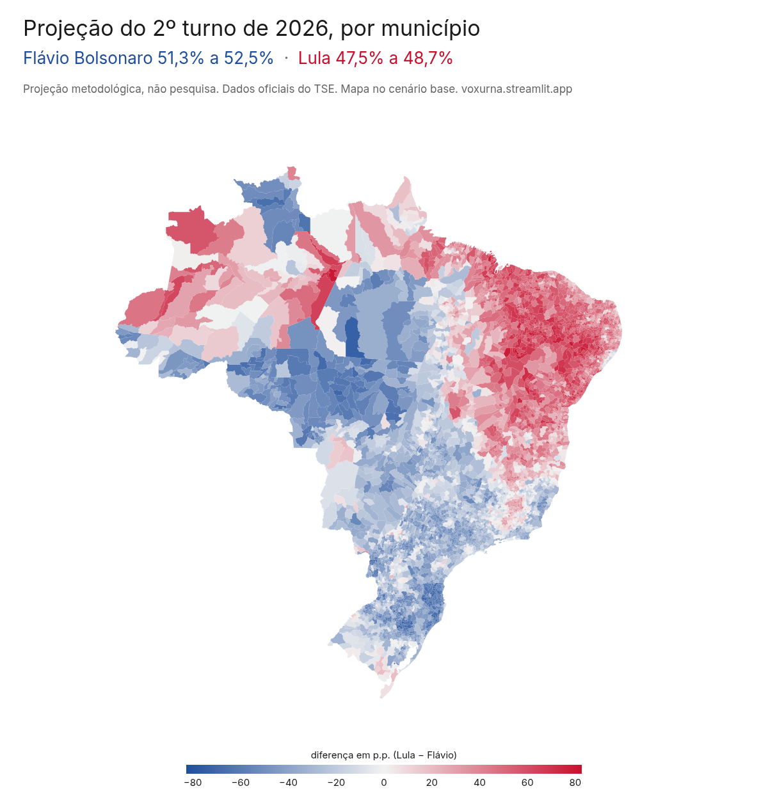

# Vox Urna

> **Não é pesquisa eleitoral.** Ninguém foi entrevistado. É uma projeção com metodologia própria, feita a partir dos dados oficiais das urnas, que o TSE deixa abertos para qualquer cidadão.

Uma projeção do 2º turno presidencial de 2026 feita só com os boletins de urna do TSE, e o pipeline de dados que chega nela.

**Dashboard:** https://voxurna.streamlit.app/



## Por que fiz isso

O resultado do 1º turno de 2026 me surpreendeu. Flávio Bolsonaro terminou com 47,0% dos votos válidos e Lula com 45,2%, uma diferença de 2,2 milhões de votos, quatro anos depois de Lula ganhar o 2º turno. O TSE publica o boletim de cada urna do país, aberto para qualquer pessoa, então fui atrás deles para entender onde isso aconteceu e o que dá para esperar do 2º turno.

Este repositório tem o pipeline inteiro, do download dos boletins até a projeção, e o dashboard que mostra o resultado. Ele também é um projeto de portfólio de engenharia de dados, com o foco na ingestão e na arquitetura medallion (bronze, silver e gold), descritas mais abaixo.

## O que os dados mostram

### Onde o lado na frente mudou

Comparei município por município o 2º turno de 2022 com o 1º turno de 2026, contando só os votos dos dois lados (Lula contra Jair Bolsonaro em 2022, Lula contra Flávio agora). Escolhi o município e não a seção porque em quatro anos a seção muda de eleitor e até de lugar, e o município fica parado.

Foram **459 municípios** que deram vitória a Lula em 2022 e agora deram a frente a Flávio, uns 8% dos 5.570 comparáveis. Minas lidera em número absoluto, com 112. No sentido contrário só apareceu um, Jequiá da Praia (AL), que foi de Flávio para Lula por 1,3 ponto. Nas cidades que viraram, o lado Lula perdeu em média 6,9 pontos, e a maior queda foi em Herveiras (RS), com 21,3.

Isso não é projeção. Quem votou em outros candidatos em 2026 ainda não escolheu um lado, então é só uma foto do 1º turno.

### E no 2º turno?

Mais de 9,3 milhões de pessoas votaram em outros candidatos no 1º turno, e ainda tem os brancos, os nulos e quem não foi votar. Para saber para onde esse pessoal costuma ir, usei os boletins de 2018 e 2022 e estimei, zona por zona, como os votos de cada grupo se moveram do 1º para o 2º turno. Depois apliquei isso aos votos de 2026, seção por seção.

Nos dois cenários, Flávio fica na frente.

| % dos votos válidos | Base (como em 2022) | Outros como em 2018 |
|---|---|---|
| Flávio Bolsonaro (PL) | 52,5% | 51,3% |
| Lula (PT) | 47,5% | 48,7% |

O cenário base supõe que cada grupo de eleitores de 2026 se divide no 2º turno do mesmo jeito que o grupo equivalente em 2022. O outro troca só os eleitores de outros candidatos, que passam a se dividir como em 2018. Eles são o grupo que menos se repete de uma eleição para a outra, por isso a manchete é a faixa entre os dois cenários.

### Quanto confiar nisso

É uma projeção, não uma certeza. O modelo supõe que cada grupo repete o que fez antes, e um fato novo na campanha pode mudar isso. Testei o mesmo método em 2022, usando 2018 para projetar o 2º turno. Ele deu Lula na frente, como aconteceu, e acertou o vencedor em 26 das 27 UFs (errou o Amapá) e em 95,8% dos municípios. Mas deu **1,7 ponto a mais para o lado Lula** do que o resultado real (52,6% projetado, 50,9% real). No dashboard esse erro fica do lado do resultado, porque achei mais honesto mostrar do que esconder.

A projeção de 2026 não é corrigida por esse viés. Corrigir seria apostar que o erro de uma única eleição se repete.

## Como a projeção é feita

O voto de cada pessoa é secreto, então ninguém sabe se quem votou em Ciro em 2022 foi de Lula ou de Bolsonaro no 2º turno. Mas cada seção publica o seu boletim, e o saldo de centenas de seções de uma mesma zona permite recuperar, por regressão, que fração de cada grupo do 1º turno foi para cada opção do 2º. Isso é a transferência de votos, escrita como β.

Por zona, com as seções como observações e tudo em fração dos eleitores aptos:

```
2T_j = Σ_k β_kj · 1T_k
k ∈ {lula, flavio, outros, branco, nulo, abstenção}   (1º turno)
j ∈ {lula, flavio, branco, nulo, abstenção}           (2º turno)

s.a.  0 ≤ β_kj ≤ 1,   Σ_j β_kj = 1
```

É o modelo de Goodman com restrições, ajustado por mínimos quadrados ponderados pelos aptos de cada seção (SLSQP do SciPy, uns 10 ms por zona). Uma zona com menos de 10 seções usa o β da UF.

Cada lado leva o nome do finalista de 2026 e liga os finalistas equivalentes de cada eleição. O lado Lula é Haddad em 2018 e Lula em 2022. O lado Flávio é Jair Bolsonaro em 2018 e 2022.

Para aplicar o β a 2026, cada seção é ligada à zona de 2022 com o mesmo município e número de zona, o que cobre 99,5% do eleitorado (a taxa de match). O resto usa a média das zonas que tinham o município em 2022 e, em último caso, o β da UF. A projeção é a soma, seção por seção, dos votos de 2026 multiplicados pelo β, agregada por zona, município, UF e Brasil.

Além do backtest, o dashboard mostra a estabilidade de cada linha do β entre 2018 e 2022 e compara o β de outros com duas pesquisas de 2022 (Datafolha e PoderData) que cruzaram o voto do 1º com o do 2º turno. O detalhe de tudo isso está em [vox-urna.md](vox-urna.md), e as decisões em [docs/adr/](docs/adr/).

## Limitações

- Inferência ecológica. O voto individual não aparece em lugar nenhum, só o saldo de cada seção, então o β descreve zonas, e não pessoas.
- A suposição central. Cada grupo de eleitores se comporta como na eleição de referência. Em 2026 o lado Flávio trocou de candidato, e isso pode mudar o comportamento.
- Um único teste histórico. O erro do backtest vem de uma eleição só. Não é margem de erro e não existe intervalo estatístico aqui.
- Taxa de match. O rezoneamento deixa 0,5% do eleitorado com um β aproximado.

## O pipeline

Uma CLI com um comando por camada (`vox-urna bronze`, `silver`, `gold`), encadeados por `make all`.

### Bronze (ingestão)

As URLs vêm da API CKAN do Portal de Dados Abertos do TSE, porque o nome de cada arquivo muda a cada republicação. Cada zip (um por UF e turno) é conferido contra o `.sha512` oficial. Um manifest guarda URL, hash, tamanho e status (`success`, `corrupted`, `failed` ou `superseded`), e o re-run pula o que já está íntegro sem consultar o servidor. Tem retry com backoff, e o arquivo bruto fica como veio.

### Silver (normalização)

Lê cada zip em streaming (o 1º turno tem uns 32 GB descomprimidos por eleição, com todos os cargos), fica só com Presidente e normaliza o que muda entre os anos, como nomes de coluna, encoding, aspas e o jeito de marcar o exterior. Grava Parquet tipado com o DuckDB em uns 2 minutos. Toda seção precisa bater as invariantes (urna apurada, soma dos votos igual ao comparecimento, aptos igual a comparecimento mais abstenção, nenhuma duplicada). A que não bate vai para quarentena com o motivo, e o build falha se a quarentena passar de 0,1%. Os totais nacionais batem voto a voto com o resultado oficial (2022, 2º turno, Lula 60.345.999 × Jair Bolsonaro 58.206.354), e só caíram em quarentena urnas que o próprio TSE anulou.

### Gold (o modelo)

A regressão por zona, a ligação com 2026, os cenários, o backtest, a estabilidade, a referência externa e as viradas por município. O build confere os lados contra o nome e o partido do boletim e falha se um 2º turno tiver voto fora deles. As tabelas pequenas ficam versionadas aqui em Parquet, e o dashboard lê só elas.

### Testes

Recortes reais pequenos do Acre de cada ano para o parsing, testes das invariantes e um teste de recuperação do modelo, com seções sintéticas geradas de um β conhecido que o estimador precisa reencontrar.

A stack é Python 3.12 (uv), DuckDB, Polars, Parquet, SciPy, Streamlit, Plotly, ruff e pre-commit.

## Como reproduzir

Precisa do [uv](https://docs.astral.sh/uv/) e de uns 8 GB livres para os boletins.

Só o dashboard, com as tabelas gold que já estão no repositório:

```sh
make dashboard
```

O pipeline inteiro, do download à projeção (baixa uns 7,6 GB do TSE na primeira vez):

```sh
uv sync
make all
make test
```

Para testar com um pedaço só, dá para baixar uma UF e um turno:

```sh
uv run vox-urna bronze --ano 2026 --turno 1 --uf AC
```

A imagem do mapa deste README sai de `make figuras`.

## Estrutura

```
src/vox_urna/
  bronze/     ingestão dos boletins (CKAN, sha512, manifest)
  silver/     extração em streaming e tabelas por seção
  gold/       transferência de votos, projeção, backtest e viradas
app/          dashboard Streamlit e a figura do mapa
tests/        testes por camada, com fixtures reais do AC
docs/adr/     decisões de arquitetura
GLOSSARY.md   vocabulário do projeto
vox-urna.md   especificação completa
```

## Depois de 25/10

Quando o TSE divulgar o 2º turno, entram os boletins dele, o confronto entre a projeção e o resultado real e o β de 2026 comparado com o de 2022.

## Fontes

- Boletins de urna de 2018, 2022 e 2026, do [Portal de Dados Abertos do TSE](https://dadosabertos.tse.jus.br/).
- Malhas de UF e município, do IBGE.
- Pesquisas Datafolha e PoderData de 2022, com registro no TSE, usadas como referência externa (os links estão no dashboard).

Feito por Romualdo Barbosa.
